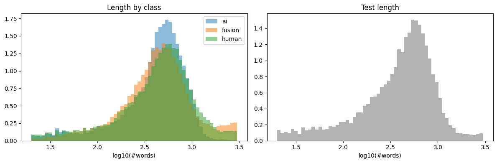
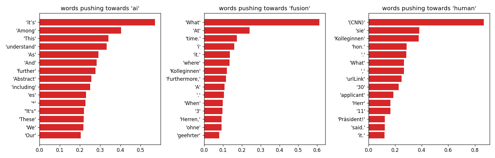
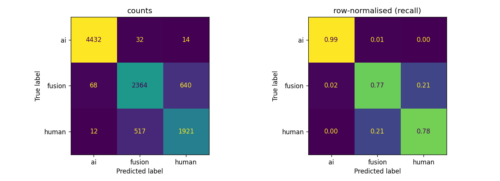
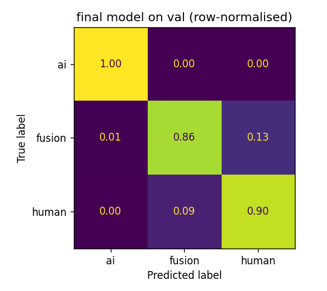

## 1. Task and setup

The task is to classify texts as **human**, **ai**, or **fusion** (human-written text partially rewritten by AI), using English and German samples drawn from eight domains. The training set has 272,352 texts and the unlabeled test set 25,000; the evaluation metric is **macro-F1**, which assigns equal weight to each class despite class imbalance. With seed 42, we held out 10,000 training texts for validation and sampled a separate 40,000 for training, stratifying both selections by label × language. All baseline and encoder results use that identical validation split; ensemble methods tuned on it are evaluated using five-fold out-of-fold predictions within validation.

## 2. Data analysis (EDA)

The training labels are imbalanced (**44.8% ai, 30.7% fusion, 24.5% human**) and depend on source: English accounts for 81% of training data versus German's 19%, while arXiv papers are 84% ai and Gutenberg texts 92% ai. Data checks found no duplicate texts, no train–test text overlap, and no texts under five words. A median text has **665 XLM-R tokens**, and **64.1%** exceed its 510-token content limit. The test distribution also shifts toward Gutenberg (7.4% vs 2.7% in train), arXiv (6.7% vs 5.2%), CNN (19.7% vs 16.3%) and blogs (17.8% vs 14.9%). Fusion retains human-like sentence-length variability (standard deviation **9.42** words vs **9.88** human and **7.37** ai), but its mean word length (**5.10**) lies between human (**4.88**) and ai (**5.61**). This predicts confusion between fusion and human rather than with ai. Accordingly, we used a label × language-stratified split and macro-F1 tuning, tested head+tail input for long documents, and evaluated language, domain and stylometric features in the ensemble.

## 3. Baseline: TF-IDF + linear models

We compared TF-IDF **word 1–2-grams**, **`char_wb` 2–5-grams**, and their concatenation, using multinomial Logistic Regression (LogReg; `C=1, 4`) and LinearSVC (`C=0.1, 0.5`). The vocabulary and IDF weights were fitted **only on the 40,000 training texts**; validation and test were transformed without refitting. Character features outperformed word features, and LogReg outperformed LinearSVC throughout the grid (Table A1). The best baseline, **word + character TF-IDF with LogReg `C=4`**, obtained **0.8468 macro-F1** (rounded to 0.847). Balanced class weights increased this by only about **0.002**. Most errors occurred between **fusion and human**: 640 fusion samples were predicted human and 517 human samples fusion (Figure A1), consistent with EDA.

## 4. Fine-tuned encoder: XLM-RoBERTa-base

We fine-tuned **`xlm-roberta-base`** because its multilingual pretraining covers both English and German (Conneau et al., 2020). Training used the same 40,000-text sample for **2 epochs**, learning rate **2×10⁻⁵**, effective batch size **32**, **fp16** mixed precision and a maximum of **512 tokens** including special tokens. To retain informative endings in long texts, each training example used its first **256** and last **254** content tokens (or the complete text if shorter), following the head+tail strategy discussed by Sun et al. (2019). Experiment A varied **inference** handling while keeping the trained model fixed (Table 1). Head+tail achieved **0.8858 macro-F1** against **0.7660** for head-only and **0.7931** for averaged overlapping chunks; the latter suffers a training–inference mismatch and can dilute informative beginning/end cues with middle sections. Head+tail also performed nearly as well on long texts alone (**0.8846**) as on all texts. It improved over the TF-IDF baseline from **0.847 to 0.886** on the same split. This inference-only comparison favors the training format; chunk-based training was not tested.

**Table 1. Long-text handling at inference (val macro-F1).**

| inference input | all texts | long texts only (> 510 tokens) |
|---|---|---|
| head only (first 510 tokens) | 0.766 | 0.668 |
| **head + tail (256 + 254)** | **0.886** | **0.885** |
| average over 512-token chunks | 0.793 | 0.719 |

## 5. Own experiments: ensembles and macro-F1 tuning

The fixed reference was **XLM-R alone (0.8858 macro-F1)**. For all methods tuned on validation, we used **five-fold stratified cross-validation inside the 10,000 validation rows**: each held-out fold was predicted by a combiner fitted or tuned on the other four, and the reported score is from the concatenated out-of-fold predictions. **E1** searched weights for a probability blend of XLM-R and TF-IDF; **E2** searched additive per-class offsets on log-probabilities to improve macro-F1; **E3** trained a Logistic Regression stacker on both models' class log-probabilities, optionally augmented with ten stylometric measurements and encoded language/domain; **E3b** tested a histogram gradient-boosting stacker with the same features (Table 2). Blending gained **+0.019**, while class offsets alone gained **+0.016**, chiefly by improving the human class. Stacking captured complementary model errors and improved macro-F1 by **+0.033**, to **0.9189**. Additional style/language/domain features contributed only about **+0.001** beyond probability-only stacking and scored **0.630** on their own; gradient boosting (**0.9183**) did not beat the simpler LogReg stacker. The final stacker was refitted on all validation rows only after out-of-fold evaluation, then used for test prediction.

**Table 2. Experiments vs the fixed reference (val macro-F1; tuned methods out-of-fold).**

| experiment | macro-F1 | F1 fusion | F1 human | Δ vs XLM-R |
|---|---|---|---|---|
| XLM-R alone (reference) | 0.886 | 0.858 | 0.809 | — |
| TF-IDF LogReg alone | 0.847 | 0.790 | 0.765 | −0.039 |
| E1: weighted blend | 0.905 | 0.879 | 0.843 | +0.019 |
| E2: class offsets on XLM-R | 0.902 | 0.865 | 0.851 | +0.016 |
| E1 + E2 | 0.907 | 0.877 | 0.851 | +0.021 |
| E3: stacking (LogReg), probabilities only | 0.918 | 0.887 | 0.872 | +0.032 |
| **E3: stacking + stylometry + lang/domain (final)** | **0.919** | **0.889** | **0.874** | **+0.033** |
| E3: stylometry + lang/domain only | 0.630 | 0.526 | 0.520 | −0.256 |
| E3b: same features, gradient boosting | 0.918 | 0.889 | 0.872 | +0.033 |

## 6. Explainability (bonus)

We examined XLM-R with **Integrated Gradients** (IG; Sundararajan et al., 2017) and **controlled text perturbations**. Averaged positive IG attributions highlighted source markers for *human*—`(CNN)`, `urlLink`, `hon.`, `Herr Präsident!`, `applicant`—and discourse openers/connectives for *ai*, including `Among`, `This`, `As`, `further` and `including`; fusion mixed both types (figure below). These source-specific signals may be dataset shortcuts rather than general markers of human authorship. For example, **152 of 153** validation texts containing a `missing …` placeholder were fusion (roughly 5% of fusion texts). Yet removing or standardizing suspected typographic artifacts changed XLM-R macro-F1 by no more than **−0.0054** (Table A2), suggesting that its predictions use multiple redundant cues. **Limitations:** IG explanations covered only the first 256 tokens and were aggregated over correctly classified examples; perturbations were evaluated for XLM-R, **not** the final ensemble, which may be more sensitive to TF-IDF artifacts.

## 7. Failed attempts and lessons

The unsuccessful approaches and engineering failures clarified the importance of matching training and inference conditions:

- **Head-only** and **chunk-averaged** inference scored 0.766 and 0.793 versus 0.886 for head+tail; chunk averaging was also approximately 2.7× slower. Because chunking was not used in training, this does not establish that chunk-based training would fail.
- **Balanced baseline weights** added only ~0.002 macro-F1; **stylometry plus language/domain alone** reached only 0.630, and **gradient-boosting stacking** (0.9183) did not improve on Logistic Regression (0.9189).
- A free **Colab** run disconnected at about 74% of its planned 5,000 training steps, with no intermediate checkpoints, so the run could not be resumed. The completed model was instead trained on **Kaggle**; checkpointing was subsequently addressed in the Colab version.
- Initial runs of notebook **04** failed because a `/content`-based environment check misidentified Kaggle as Colab and tried to mount Google Drive. Checking for `/kaggle/input` fixed the issue.

## 8. Final model and how to run

The selected final model is **E3 Logistic Regression stacking with base-model probabilities, stylometry, language and domain** (bold row in Table 2): validation macro-F1 **0.9189** and public leaderboard **0.91924**. The close agreement is encouraging for this test distribution, although the private leaderboard and unseen source domains may behave differently. Two Kaggle submissions were selected: **`submission_ensemble.csv`** from notebook **04** (public **0.91924**, main) and **`submission_xlmr.csv`** from notebook **03** (public **0.87863**, single-model backup). Reproduce in order: **01** EDA/split → **02** TF-IDF → **03** XLM-R (GPU) → **04** ensembles → **05** explainability; notebook 04 reads probability outputs of 02 and 03, while 05 loads the model from 03. The code README documents runtime settings and inputs; seed 42 reproduces the split, though GPU training need not be bitwise deterministic.

| submission | val macro-F1 | public LB | selected |
|---|---|---|---|
| TF-IDF baseline (`submission_baseline.csv`) | 0.847 | 0.853 | |
| XLM-R head+tail (`submission_xlmr.csv`) | 0.886 | 0.879 | ✓ |
| Stacking ensemble (`submission_ensemble.csv`) | 0.919 | 0.919 | ✓ |

## Appendix

**Table A1. Baseline grid (val macro-F1).**

| features | LogReg C=1 | LogReg C=4 | LinearSVC C=0.1 | LinearSVC C=0.5 |
|---|---|---|---|---|
| word 1–2 | 0.818 | 0.821 | 0.797 | 0.804 |
| char_wb 2–5 | 0.843 | 0.844 | 0.827 | 0.835 |
| word + char | 0.846 | **0.847** | 0.832 | 0.834 |

**Table A2. Perturbation test on XLM-R (val, reference 0.886).**

| change applied to val texts | texts changed | macro-F1 | Δ |
|---|---|---|---|
| curly → straight quotes | 3,836 | 0.886 | +0.000 |
| remove "missing …" placeholders | 153 (152 fusion) | 0.886 | −0.000 |
| remove sentences with "let me know" | 138 | 0.885 | −0.001 |
| remove space before punctuation | 2,277 | 0.880 | −0.005 |

**References.** Conneau et al. (2020) XLM-R; Sun et al. (2019) How to Fine-Tune BERT for Text Classification?;
Sundararajan et al. (2017) Axiomatic Attribution for Deep Networks. Code: own notebooks 01–05 (written with an AI
coding assistant, as allowed)
